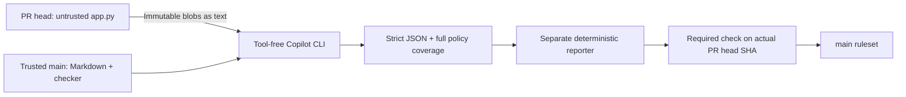

# Markdown + LLM: a required PR merge gate

This public, synthetic teaching demo uses a readable
[three-rule security standard](SECURITY_STANDARD.md) and a real Copilot CLI
review of a tiny Python/SQLite directory. A deterministic reporter validates
the model's complete JSON review and publishes **`Markdown + LLM security gate`**
on the exact PR head SHA. HIGH/CRITICAL findings and unsuccessful or incomplete
reviews fail the check. The default and protected branch is always **`main`**.

**Required checks block merging, not PR creation.** Both examples can be opened;
the violating example cannot merge once the required-check ruleset is active.
A local pre-creation wrapper is bypassable via GitHub's web UI or API. Both
demo PRs are intentionally left **open and unmerged**.

## Live evidence

Real Copilot reviews completed on November 4, 2026:

| Open, unmerged PR | App-only change | Observed model/check result | Actions evidence |
|---|---|---|---|
| [#1: parameterized email](https://github.com/ShawnMcGough/markdown-llm-security-gate-demo/pull/1) | `find_by_email` uses `?` and `(email,)` | All three rules pass, no findings; check **success** | [Successful review](https://github.com/ShawnMcGough/markdown-llm-security-gate-demo/actions/runs/41895604488) |
| [#2: interpolated email](https://github.com/ShawnMcGough/markdown-llm-security-gate-demo/pull/2) | Same feature uses f-string SQL | **SEC-001 / HIGH**, `app.py:28`; check **failure** | [Policy violation](https://github.com/ShawnMcGough/markdown-llm-security-gate-demo/actions/runs/41895604216) |

These are the first successful end-to-end snapshots, reviewed against trusted
base `9352b69897e6b38111de3d12b47417d5adfc21ee`. Their reviewed heads are
`f52910bfdcc3f220811bfcef173906760757246a` (pass) and
`e70369aca289f6404ae6427c880f1c82e8a12fd0` (fail). Both published the exact named
check from GitHub Actions App **15368** on the correct head. The unsafe review
job itself succeeded; the decision failed because of the actual model finding.
These historical runs predate the display-name/reporting-status improvements
described below; the updated reporter does not duplicate a valid policy failure.
The model traced `--email` through `main` into interpolated SQL, explaining how
input could alter the WHERE clause and return unrelated rows.

The PR links show current heads and newer reviews after final documentation
updates. Use the inspection commands below for current evidence and enforcement,
rather than treating these historical SHA snapshots as the latest state.
Setup ends by activating [the main ruleset](https://github.com/ShawnMcGough/markdown-llm-security-gate-demo/rules/26558788)
with no bypass actors. Both PRs must remain open and unmerged.

The initial runs exposed a real CLI transport issue: terminal-text output
hard-wrapped inside JSON strings, so strict parsing correctly failed closed.
Switching to JSONL fixed the transport without relaxing validation or repairing
model output. Automatic PR creation and head-update triggers both ran.
The original 33 Node parser tests, 12 new transport tests, and three Python
tests pass; local email/injection behavior was also checked for both branches.
None of these fixtures/probes substitutes for the linked live model evidence.

The owner explicitly authorized making this personal repository public so
GitHub Free can enforce branch rules. Keeping it private would require GitHub
Pro (the private ruleset/protection APIs returned an upgrade-required 403).
No billing upgrade, PAT, bypass, or change to the former repository is needed.

## What is here

| File | Purpose |
|---|---|
| `SECURITY_STANDARD.md` | Three readable rules, IDs, severities |
| `app.py` | Stdlib-only in-memory directory with two synthetic records |
| `.github/workflows/security-gate.yml` | Trusted PR-triggered review and manual rerun |
| `gate/core.mjs` | Prompt, strict JSON schema/coverage/severity checks |
| `gate/run.mjs` | Immutable snapshots, isolated CLI, separate check reporter |
| `gate/core.test.mjs` | Fail-closed review and CLI-transport tests, not model detection |
| `gate/run.test.mjs` | Reporter integration fixtures separating policy rejection from job errors |
| `gate/configure.mjs` | Administrator setup/inspection of the main ruleset |
| `.github/CODEOWNERS` | Base-branch ownership of policy, gate, workflows, itself |
| `tests/test_app.py` | Three baseline functional tests |

The feature PRs add `--email` lookup to the same application.
**The failing branch is intentionally insecure, educational, and never for production.**
Do not merge or deploy either demonstration PR.

## Authentication and cost

Actions uses its short-lived `GITHUB_TOKEN` with `contents: read` and
`copilot-requests: write`; **no PAT or repository secret is needed for review**.
The personal repository owner's usable Copilot seat is billed. Organization
repositories also need their "Allow use of Copilot CLI billed to the organization"
policy enabled. Each PR creation/update/manual rerun can consume Copilot AI
credits. Hosted-runner availability, Actions usage/billing, and Copilot budgets
remain subject to the account's plan and settings; public visibility does not
make model requests free.

The workflow installs **`@github/copilot@1.0.105`**, using its supported default
model (not the model selected in the Copilot App). Local setup needs Git,
authenticated `gh`, Node.js 22+, and Python 3; no local dependencies are needed.
Verify `gh api user --jq .login` before administrative operations. When multiple
accounts are configured, select the personal token **only in the current process**:

```powershell
$env:GH_TOKEN = (gh auth token --hostname github.com --user ShawnMcGough).Trim()
gh api user --jq .login
```

Never print or commit the token. This local administrator credential is not
copied into Actions.

Official references (November 4, 2026):
[Copilot CLI with Actions GITHUB_TOKEN](https://docs.github.com/en/copilot/how-tos/copilot-cli/use-copilot-cli-in-actions),
[authentication and billing](https://docs.github.com/en/copilot/concepts/agent-capabilities/agent-powered-workflows-and-operations/copilot-cli-in-github-actions),
[rulesets](https://docs.github.com/en/repositories/configuring-branches-and-merges-in-your-repository/managing-rulesets/about-rulesets).

## Presenter walkthrough

1. Open `main` and [SECURITY_STANDARD.md](SECURITY_STANDARD.md). Explain SEC-001:
   command-line input is external input and must remain a SQL parameter.
2. Run the harmless baseline locally:

   ```powershell
   python app.py alice
   python -m unittest discover -s tests
   npm test
   ```

   It prints `alice: alice@example.test`. Local tests do not call the model.
3. Open the parameterized PR's **Files changed**; point out the `?` placeholder
   and separate tuple. In **Checks**, open **Markdown + LLM security gate**:
   inspect all three policy assessments and the findings.
4. Open the interpolated PR; show the unsafe f-string and non-production
   warning. The intended failure is **SEC-001 / HIGH**, with a source line and
   input-to-SQL explanation, not a workflow error.
5. Follow the custom check's **Details** link to **Actions > Markdown security
   review**. The **3. Validate review and publish merge verdict** summary includes head/base SHAs, source blob IDs,
   policy digest, CLI version, and validated findings. Download
   **`llm-review-<attempt>`** for raw `cli-events.jsonl`, extracted
   `model-response.txt`, and validated `review.json`.
   Infrastructure errors may include `cli-error.txt`. Artifacts expire in 14 days.
6. In **Settings > Rules > Rulesets**, inspect **Require Markdown and LLM review
   on main**: active enforcement, no bypass actors, and the required check bound
   to the actual GitHub Actions App. Check the passing PR's merge eligibility and
   the failing PR's blocked merge box, without merging either.

### Reading the checks panel

The three workflow jobs perform the review process; the separate required check
is the policy verdict. Job IDs stay `start`, `review`, and `decision` internally,
but GitHub displays the following teaching-oriented names:

| Displayed check | What a green result means |
|---|---|
| **1. Prepare PR snapshot and pending gate** | Captured the head/base commits and created a pending required check; no security judgment yet |
| **2. Review code against Markdown policy** | Copilot returned a complete, valid assessment of every rule; findings may still be present |
| **3. Validate review and publish merge verdict** | The reporter validated the evidence and successfully published the verdict, whether allow or reject |
| **Markdown + LLM security gate** (**Required**) | The reviewed code satisfies the configured policy threshold and can satisfy this merge requirement |

For the unsafe example, expect **one failed required gate and three successful
jobs**. An invalid/missing review or infrastructure error still fails the
appropriate job and leaves the required gate failed, missing, or pending.
A green workflow/job result alone is **not** evidence that merging is allowed.
The required check's name and App binding are unchanged.

GitHub does not provide a workflow setting to hide individual job-check rows in
the PR merge box. Collapse **successful checks** to focus on the failed required
gate. The named steps and each job's Actions summary explain the process in more
detail. For a required-check-only CLI view, use `gh pr checks PR_NUMBER --required`.

From this checkout, inspect current evidence:

```powershell
gh pr list --state open --base main
gh pr view demo/pass-parameterized-email --json url,headRefOid,state,mergedAt,mergeStateStatus
gh pr view demo/fail-interpolated-email --json url,headRefOid,state,mergedAt,mergeStateStatus
gh pr checks demo/pass-parameterized-email --required
gh pr checks demo/fail-interpolated-email --required
node gate/configure.mjs inspect
```

### Rerun and new-head demonstration

In **Actions > Markdown security review > Run workflow**, select **main** and
enter the open PR number. Or replace `PR_NUMBER` below with its number:

```powershell
gh workflow run security-gate.yml --ref main -f pr_number=PR_NUMBER
gh run list --workflow security-gate.yml --limit 5
gh run watch RUN_ID --exit-status
```

A valid policy rejection fails the required check, not the reporting process.
Do not use the workflow conclusion alone as a merge verdict; inspect
`gh pr checks PR_NUMBER --required`. Use **Re-run all jobs**, not only failed
jobs: start, review, and decision must share an attempt identity.
A manual dispatch always uses current `main` and current PR state.

To show head-SHA binding, add an explanatory `app.py` comment on a demo branch,
commit, and push. The `synchronize` event triggers another real model review.
An older head's successful check cannot satisfy the new head. Only `app.py`
may change; branches must be up to date with `main`.

On either known synthetic feature branch, demonstrate the behavior locally:

```powershell
python app.py --email alice@example.test
python app.py --email "' OR '1'='1"
```

The parameterized implementation returns no rows for the second input; the
deliberately interpolated implementation returns both records. The privileged
workflow **never runs these probes or candidate code**. Branch names, regex,
SAST, and fixtures do not determine the policy verdict.

## Bootstrap a new demo

These are administrator steps **before protection**. Never disable/bypass an
installed gate to repeat them. For this configured repository, use the presenter
steps instead.

1. Create a repository on the intended account with default branch **main**.
   Choose visibility explicitly; private repositories need a plan supporting
   rulesets and required CODEOWNER reviews. Never rename the default branch.
2. Copy the trusted source, set `.github/CODEOWNERS` to the trusted owner with
   write/admin access, run both local test commands, then commit/push the baseline
   directly to `main`. Do this only before installing protection.
3. Run `node gate/configure.mjs stage`. A disabled ruleset verifies API support
   but enforces nothing. A 403 must be resolved through an authorized plan or
   visibility decision, not a bypass.
4. From the same `main`, create `demo/pass-parameterized-email` and
   `demo/fail-interpolated-email`. Change only `app.py`; implement the same
   `find_by_email` and `--email` feature with parameters in one and interpolation
   plus a prominent educational warning in the other. Commit/push each, then:

   ```powershell
   gh pr create --base main --head demo/pass-parameterized-email --title "PASS: parameterized email lookup" --body "Educational demo: expected SEC-001 compliance. Leave open and unmerged."
   gh pr create --base main --head demo/fail-interpolated-email --title "FAIL: deliberately unsafe email lookup" --body "Intentionally insecure educational example. Expected SEC-001 HIGH. Do not merge or deploy."
   ```

5. Let both real reviews finish. Resolve actual infrastructure problems; a red
   bootstrap error is not evidence that the LLM detected insecure SQL. Finalize
   documentation before protection, update feature branches to current `main`,
   and obtain fresh reviews of their current heads.
6. Run `node gate/configure.mjs enable`, then `node gate/configure.mjs inspect`.
   Verify the active main-only ruleset, empty bypass list, published GitHub
   Actions App ID, strict up-to-date required check, PR requirement, CODEOWNER
   review on owned files, stale approval dismissal, and force-push/deletion blocks.
7. Verify both PRs are OPEN with `mergedAt: null`, one clean and one blocked.
   Do not merge to test enforcement.

## Trust boundary and limitations



`pull_request_target` checks out only the trusted base SHA with credentials
not persisted. Candidate code is never checked out, imported, installed, or
executed. Git blobs are length-, encoding-, and hash-checked. The one-file scope
and 20 KB cap fail closed rather than silently truncating context.

Copilot runs in a fresh directory/HOME/COPILOT_HOME without repository settings,
custom instructions, built-in MCPs, or available tools, with explicit
shell/write/URL denials. It has no checks-write permission. The separate
reporter has no copilot-requests permission and never executes model output.
Only approved GitHub/Copilot services receive this synthetic source.
The CLI uses machine-readable JSONL, not rendered terminal text (which can
hard-wrap inside JSON strings). Exactly one complete assistant message and a
successful final CLI completion are required. Malformed model JSON is never
repaired or inferred from partial streaming deltas.

The reporter recomputes immutable snapshot identity before publishing, requires
every policy rule exactly once, validates finding severity and source locations,
and computes the threshold itself. Missing/error/skipped/timed-out jobs,
missing/malformed/partial output, stale head/base, and artifact mismatch cannot
produce success. The decision job and publishing step use `always()`. A reporter
failure leaves the custom check missing/pending; success is never synthesized.
GitHub can accept skipped/neutral ordinary checks, so the required check is this
custom pending/success/failure check, **not** the base-SHA native workflow jobs.

**Trusted-writer demo only.** A personal repository cannot use push rulesets.
Base CODEOWNERS protects policy/checker/workflow changes merged into `main`,
but does **not** stop a hostile writer using another branch workflow to forge
the same Actions-App check on a different SHA. App/name binding is not
workflow-origin attestation. Stronger deployments need organization no-bypass
push/required-workflow controls or a separately secured reporter App; neither
is provisioned here. Administrators who can change rules remain trusted.

LLMs may miss issues, vary, or follow prompt injection. Isolation limits
authority, not semantic mistakes; use human review and security tooling in
production. The CLI is pinned but its default model is not. Fork PRs and merge
queues are unsupported. Infrastructure changes are rejected by this narrow
app-only gate and require a separately approved maintenance design; do not
temporarily disable protection to force a demonstration through.
